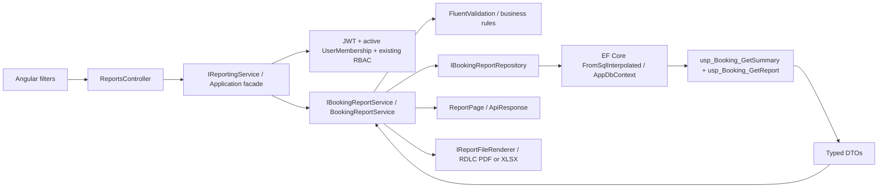

# Standard Stored Procedure Integration

## Approved architecture and inspection

The existing solution is ASP.NET Core 8 / EF Core 8 / SQL Server, with Angular 19. API references Application and Infrastructure; Infrastructure references Application/Domain; Application references Domain. These project references are unchanged. No new ORM or package was introduced.

Before changes, ReportingService in Infrastructure combined parameterized ADO.NET execution, dictionary mapping and RDLC rendering. ReportsController resolved tenant/membership and permissions. The project already provided ApiResponse<T>, FluentValidation registration, scoped repositories, AppDbContext, IUserMembershipRepository, IReportAccess, JWT claims, global Super Admin checks and global exception middleware. ITenantResolver resolves a public domain only; authenticated report access continues to use the existing JWT + active UserMembership rules, not an untrusted domain/header alone.

Actual SQL schema was inspected before new SQL was written: Bookings (43 columns), Users (18), PaymentTransactions (21), BookingStayDates (9). Booking monetary columns and payment Amount are decimal(18,2). Existing report predicates, joins, date semantics, RDLC fields and indexes were reused.

### Mapping

| Component | Previous | Standard implementation |
| --- | --- | --- |
| Request | ReportFilter | Reused, with shared FluentValidation |
| Result | Dictionary rows | Separate typed DTO for Booking, Revenue, Customer, Occupancy |
| HTTP | ReportsController with access/business rules | Thin controller, common ApiResponse<T>, HTTP error mapping |
| Application facade | Interface only | ReportingService: authenticated context, dispatch, export concurrency, audit scope |
| Module services | No separate services | IBookingReportService/BookingReportService, equivalent services for the other three reports |
| Repository contracts | Missing for report results | Four typed module repository interfaces plus shared read/summary contract |
| Database execution | ADO.NET in Infrastructure service | EF Core FromSqlInterpolated in Infrastructure repositories |
| SQL | Two result sets in legacy report procedures | One result set per GetReport / GetSummary procedure |
| RDLC | Combined with database execution | ReportFileRenderer consumes typed result objects; no database access or DataTable |
| Mapping | Reader/DataTable mapping | Keyless, no-tracking DTO mappings in existing AppDbContext |



## Final folder structure

```text
FarmStay/Controllers/Reporting/ReportsController.cs
FarmStay/DependencyInjection/{ApplicationServiceRegistration,InfrastructureServiceRegistration}.cs
FarmStay.Application/
  DTOs/Reports/{Booking,Revenue,Customer,Occupancy}/Responses/*ReportResponseDto.cs
  Reporting/{IReportingService,ReportModels,ReportExecution}.cs
  Interfaces/Services/Reports/{IReportModuleService,I*ReportService}.cs
  Interfaces/Repositories/Reports/{IReportRepository,I*ReportRepository}.cs
  Services/Reports/ReportingService.cs
  Services/Reports/ReportModuleService.cs
  Services/Reports/{Booking,Revenue,Customer,Occupancy}/*ReportService.cs
  Validators/Reports/ReportFilterValidator.cs
FarmStay.Infrastructure/
  Data/AppDbContext.cs
  Repositories/Reports/ReportRepository.cs
  Repositories/Reports/{Booking,Revenue,Customer,Occupancy}/*ReportRepository.cs
  Reporting/ReportAccess.cs
  Reporting/ReportFileRenderer.cs
  Reporting/Mapping/ReportResultConfiguration.cs
  Reporting/Sql/Standard/*_{GetReport,GetSummary}.sql
  Reporting/Templates/{bookings,revenue,customers,occupancy}.rdlc
  Migrations/20261120143334_StandardStoredProcedureIntegration.*
```

## Booking Report: reference implementation

The first Booking Report implementation was tested before reusing the pattern for Revenue, Customer and Occupancy.

- ReportFilter is reused to preserve the existing Angular form/query contract. Tenant ID is not a request DTO property.
- ReportFilterValidator validates dates, month/year, period mode, paging, search length, booking type and source; application services validate independently of MVC.
- BookingReportResponseDto maps BookingReference, FullName, MobileNumber, CreatedDate, CheckInDate, CheckOutDate, BookingType, BookingSource, PersonCount, Status and decimal TotalAmount.
- Text properties are nullable where SQL may return NULL. JSON property names preserve existing PascalCase row keys used by the Angular column definitions. The outer envelope remains camelCase.
- ReportTotalResponseDto maps COUNT_BIG(*) AS TotalRecords to long. ReportPage<T> includes columns, typed rows, total, page, pageSize and periodLabel.
- BookingReportService delegates to IBookingReportRepository after validation/access checks.
- BookingReportRepository passes only safe interpolated SQL parameters to constant procedure names. It does not resolve identity or implement HTTP/business decisions.
- FromSql EXEC queries are materialized with AsNoTracking().ToListAsync(ct) before Single()/other client-side operations. Never compose SingleAsync, CountAsync or Where over a SQL Server EXEC.
- Existing DbContext owns the connection and transaction. Repositories do not open/close a connection or construct commands/readers/parameters. EF's existing transaction is automatically used.
- A 60-second command timeout applies only for report execution; the prior context timeout is restored in finally.

### SQL procedures

| Module | Rows | Count |
| --- | --- | --- |
| Booking | dbo.usp_Booking_GetReport | dbo.usp_Booking_GetSummary |
| Revenue | dbo.usp_Revenue_GetReport | dbo.usp_Revenue_GetSummary |
| Customer | dbo.usp_Customer_GetReport | dbo.usp_Customer_GetSummary |
| Occupancy | dbo.usp_Occupancy_GetReport | dbo.usp_Occupancy_GetSummary |

Each procedure uses SET NOCOUNT ON, explicit columns, mandatory tenant predicates, deterministic sorting, literal-prefix search and parameterized inputs. The summary is exactly one row/result set with TotalRecords. Rows and summary are separate calls; the same procedure is not repeated to extract another result set.

All procedures take @FarmHouseId, @FromDate, @ToDateExclusive and @Search. Only Booking takes @BookingType and @Source. Only row procedures take @Page and @PageSize. No unused booking filters are sent to other SQL procedures. Financial row values explicitly use decimal(18,2); aggregated customer booking value uses decimal(38,2).

Rows use OFFSET/FETCH. Existing covering/filtered indexes are reused; no duplicate indexes were added by the standard integration migration. Date upper bounds are exclusive, preserving the complete selected To date.

### Keyless mappings and deployment

Existing AppDbContext is reused. ReportResultConfiguration declares five keyless, read-only logical view mappings. These names are query metadata, not physical views. Every data read supplies FromSql EXEC. No report DTO tables/views, Domain entities or relationships were created.

The new migration creates eight new canonical procedures. Existing migration files and legacy usp_Report_* procedures are preserved for compatibility. Generated unrelated seed audit-date updates were removed and original snapshot seed dates retained. No application data, relationship, existing table or index is changed by this migration.

```powershell
dotnet build FarmStay/FarmStay.API.csproj -m:1
dotnet ef database update StandardStoredProcedureIntegration --no-build --project FarmStay.Infrastructure --startup-project FarmStay -- --environment Development
```

## API documentation

Existing routes are preserved:

- GET /api/administration/reports: authorized catalog, with canExport per report.
- GET /api/administration/reports/{bookings|revenue|customers|occupancy}: paginated data.
- GET /api/administration/reports/{report}/export/{pdf|excel}: RDLC PDF or real XLSX file.

Authentication: Authorization: Bearer token. FarmHouseId header selects a farmhouse; the application validates it against JWT claims and active membership, with existing global Super Admin behavior. It is never trusted as client identity or accepted from body/query DTO.

Request examples:

```text
/api/administration/reports/bookings?period=range&fromDate=2026-11-01&toDate=2026-11-30&bookingType=event&source=assisted&page=1&pageSize=25
/api/administration/reports/revenue?period=month&month=11&year=2026
/api/administration/reports/customers?period=year&year=2026
/api/administration/reports/occupancy?period=all&search=2026-11
/api/administration/reports/bookings/export/excel?period=all
```

- period: range/month/year/all; defaults to month (supply month/year).
- page: 1..1,000,000; pageSize: 1..100; search: optional literal prefix, max 100 characters.
- bookingType: all/normal/event; source: all/online/assisted. Only Booking uses these extra filters.
- normal = BookingOnly; event = NormalEvent/DecorationEvent; assisted = WalkIn/Phone.

```json
{
  "success": true,
  "message": "Report fetched successfully.",
  "data": {
    "columns": [{"key":"BookingReference","label":"Booking number","kind":"text"}],
    "rows": [{"BookingReference":"FS-2026-001"}],
    "total": 1,
    "page": 1,
    "pageSize": 25,
    "periodLabel": "All dates"
  }
}
```

The abbreviated example omits other typed Booking fields/column descriptors. Typed responses match the existing report UI; no Angular change is required.

Controller maps application validation to 400, authentication to 401, authorization to 403, unknown/inactive resources to 404 and export-limit errors to 413, using the existing ApiResponse<T>. Standard ASP.NET model-binding errors retain the project's existing behavior. Unexpected failures continue through existing global exception middleware. Repository exceptions are logged internally and wrapped with a safe generic message, not raw SQL parameters.

## Security and audit

Admin/Owner require separate View/Export permissions per report. Customer roles cannot access reports. Active user, role, membership, farmhouse, enabled module and permission checks are preserved. Global Super Admin rules are reused. Authorization now resides in the application facade/module services; repositories only receive resolved, validated tenant parameters. Controllers retain role attributes and HTTP handling.

Audit scopes include report key, user ID, resolved farmhouse and correlation/request ID. Repository logs include procedure name, duration and row count; failures are logged with procedure context. Never log filters, mobile/email values, credentials, JWTs or confidential payment values.

## Semantics, limits and performance

Booking/Customer periods use booking submission dates, including cancelled/rejected bookings. Customer counts are unique customers with matching bookings. Revenue is successful Advance/Checkout receipts, not booking value. Occupancy groups scheduled stay dates for Confirmed/CheckedIn/CheckedOut bookings, not actual attendance/capacity percentage.

Exports use applied filters/search independently of UI paging. PDF max 10,000 matching rows; XLSX max 100,000. Count is checked before loading export rows; an extra row detects a concurrent insert exceeding the limit, with no silent truncation. At most two complete exports run per API process. Live reports are not immutable accounting snapshots; data may change between summary and row calls.

Query timing is logged. Existing small-data timings are not a large-volume SLA. Test actual production volumes/plans/hardware before promising sub-second responses; exact All counts and deep OFFSET pages remain proportional to matches.

## Dependency injection

Application registration owns IReportingService and four I*ReportService implementations. Infrastructure registration owns four I*ReportRepository implementations, IReportAccess and IReportFileRenderer. ReportFilterValidator is discovered by the existing FluentValidation assembly scan. All are scoped; no duplicate registrations or new DbContext/ORM.

## Verification and protected functionality

Completed before broader reuse: Booking typed FromSql rows/count, paging, empty results, date validation, permission gating, cancellation, no-tracking, inherited EF transaction and PDF/XLSX. Temporary reference SP creation was rolled back.

Completed after reuse: four module DI paths and SPs, exact counts against LINQ, range/month/year/all boundaries, booking type/source, literal malicious-looking search, typed JSON row-key compatibility, empty results, PDF/XLSX files and empty PDF, service-level customer/cross-tenant denial, cancellation, and no physical DTO tables/views. Final HTTP and regression results are recorded below after verification.

Existing Booking, Pricing, Calendar, authentication, membership, payment/notification flows and relationships are untouched. Existing payment receipt rendering is a separate frozen integration and was not migrated as part of the four-report module standardization.

## Adding the next SP

1. Inspect real schema/nullability and existing request/response conventions first.
2. Reuse ReportFilter where appropriate; add a dedicated request/validator only for a distinct request shape.
3. Add a typed response DTO with exact SQL column types/names. Use no Domain entity for report output.
4. Add module service/repository interfaces and implementations following Booking.
5. Add keyless mapping to the existing ReportResultConfiguration; do not create a result table or separate context.
6. Add versioned GetReport/GetSummary SQL scripts with mandatory tenant predicates and only needed parameters. Never edit a deployed migration/resource; create a new migration/version.
7. Use FromSqlInterpolated with constant procedure names, AsNoTracking and ToListAsync(ct), not direct ADO.NET or composed EXEC queries.
8. Register through the existing Application/Infrastructure DI methods; add catalog/renderer metadata and reuse existing RBAC provisioning.
9. Verify DTO/null mapping, validation, paging/summary, transaction/timeout/cancellation, exports, denial paths, tenant isolation and unchanged existing APIs before reuse.

## Complete changed-file list

- `FarmStay.Application/DTOs/Reports/Booking/Responses/BookingReportResponseDto.cs`
- `FarmStay.Application/DTOs/Reports/Customer/Responses/CustomerReportResponseDto.cs`
- `FarmStay.Application/DTOs/Reports/Occupancy/Responses/OccupancyReportResponseDto.cs`
- `FarmStay.Application/DTOs/Reports/Revenue/Responses/RevenueReportResponseDto.cs`
- `FarmStay.Application/Interfaces/Repositories/Reports/IBookingReportRepository.cs`
- `FarmStay.Application/Interfaces/Repositories/Reports/ICustomerReportRepository.cs`
- `FarmStay.Application/Interfaces/Repositories/Reports/IOccupancyReportRepository.cs`
- `FarmStay.Application/Interfaces/Repositories/Reports/IReportRepository.cs`
- `FarmStay.Application/Interfaces/Repositories/Reports/IRevenueReportRepository.cs`
- `FarmStay.Application/Interfaces/Services/Reports/IBookingReportService.cs`
- `FarmStay.Application/Interfaces/Services/Reports/ICustomerReportService.cs`
- `FarmStay.Application/Interfaces/Services/Reports/IOccupancyReportService.cs`
- `FarmStay.Application/Interfaces/Services/Reports/IReportModuleService.cs`
- `FarmStay.Application/Interfaces/Services/Reports/IRevenueReportService.cs`
- `FarmStay.Application/Reporting/IReportingService.cs`
- `FarmStay.Application/Reporting/ReportExecution.cs`
- `FarmStay.Application/Reporting/ReportModels.cs`
- `FarmStay.Application/Services/Reports/Booking/BookingReportService.cs`
- `FarmStay.Application/Services/Reports/Customer/CustomerReportService.cs`
- `FarmStay.Application/Services/Reports/Occupancy/OccupancyReportService.cs`
- `FarmStay.Application/Services/Reports/ReportModuleService.cs`
- `FarmStay.Application/Services/Reports/ReportingService.cs`
- `FarmStay.Application/Services/Reports/Revenue/RevenueReportService.cs`
- `FarmStay.Application/Validators/Reports/ReportFilterValidator.cs`
- `FarmStay.Infrastructure/Data/AppDbContext.cs`
- `FarmStay.Infrastructure/FarmStay.Infrastructure.csproj`
- `FarmStay.Infrastructure/Migrations/20261120143334_StandardStoredProcedureIntegration.Designer.cs`
- `FarmStay.Infrastructure/Migrations/20261120143334_StandardStoredProcedureIntegration.cs`
- `FarmStay.Infrastructure/Migrations/AppDbContextModelSnapshot.cs`
- `FarmStay.Infrastructure/Reporting/Mapping/ReportResultConfiguration.cs`
- `FarmStay.Infrastructure/Reporting/README.md`
- `FarmStay.Infrastructure/Reporting/ReportFileRenderer.cs`
- `FarmStay.Infrastructure/Reporting/ReportingService.cs`
- `FarmStay.Infrastructure/Reporting/Sql/Standard/Booking_GetReport.sql`
- `FarmStay.Infrastructure/Reporting/Sql/Standard/Booking_GetSummary.sql`
- `FarmStay.Infrastructure/Reporting/Sql/Standard/Customer_GetReport.sql`
- `FarmStay.Infrastructure/Reporting/Sql/Standard/Customer_GetSummary.sql`
- `FarmStay.Infrastructure/Reporting/Sql/Standard/Occupancy_GetReport.sql`
- `FarmStay.Infrastructure/Reporting/Sql/Standard/Occupancy_GetSummary.sql`
- `FarmStay.Infrastructure/Reporting/Sql/Standard/Revenue_GetReport.sql`
- `FarmStay.Infrastructure/Reporting/Sql/Standard/Revenue_GetSummary.sql`
- `FarmStay.Infrastructure/Repositories/Reports/Booking/BookingReportRepository.cs`
- `FarmStay.Infrastructure/Repositories/Reports/Customer/CustomerReportRepository.cs`
- `FarmStay.Infrastructure/Repositories/Reports/Occupancy/OccupancyReportRepository.cs`
- `FarmStay.Infrastructure/Repositories/Reports/ReportRepository.cs`
- `FarmStay.Infrastructure/Repositories/Reports/Revenue/RevenueReportRepository.cs`
- `FarmStay/Controllers/Reporting/ReportsController.cs`
- `FarmStay/DependencyInjection/ApplicationServiceRegistration.cs`
- `FarmStay/DependencyInjection/InfrastructureServiceRegistration.cs`

## Final verification results (20 November 2026)

- Backend build: succeeded, zero errors (existing warnings remain).
- Migration StandardStoredProcedureIntegration: applied successfully.
- Booking reference: FromSql rows/summary, inherited EF transaction, no tracking, cancellation, date validation, paging and PDF/XLSX passed before pattern reuse.
- Four modules: typed DTOs, exact totals versus LINQ, range/month/year/all, source/type filters, empty results, SQL NULL materialization and frontend-compatible JSON keys passed.
- RDLC: all four PDF/XLSX exports and an empty report passed. The PDF layout was rendered and visually checked; existing headings, totals and page numbers were preserved.
- HTTP: catalog, four paginated list routes, PDF/XLSX downloads, common validation envelopes, 400/401/403/404 responses passed.
- Security: anonymous/customer denial, query-string tenant ignored, cross-tenant header denial, global Super Admin, independent export revocation and disabled-module denial passed. Permission test changes were rolled back.
- Regression: existing admin booking list, customer bookings, pricing and calendar month endpoints passed.
- No report DTO tables or physical views were created. Canonical SP reads use EF Core FromSqlInterpolated only; no direct ADO.NET remains in the four-report integration.
- Frontend report route responded HTTP 200; anonymous reporting endpoint responded HTTP 401. Updated backend is running locally.
- Current small-data checks do not establish a large-volume performance SLA; large-volume load testing was not performed.

Local verification harness and generated samples are ignored under `.receipt-verification/`; they contain no production changes and are not application source. No GitHub push was performed for this implementation.
